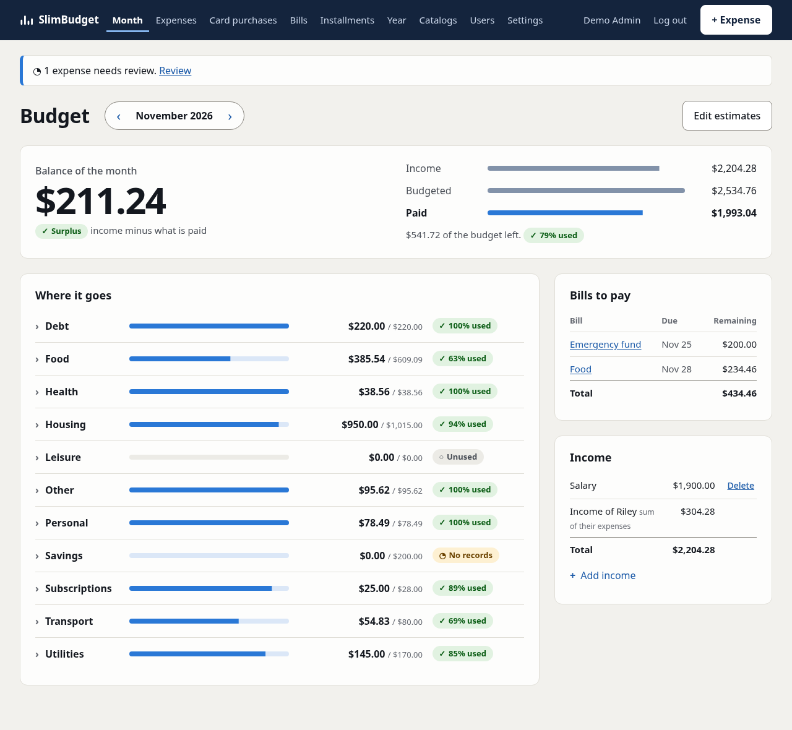
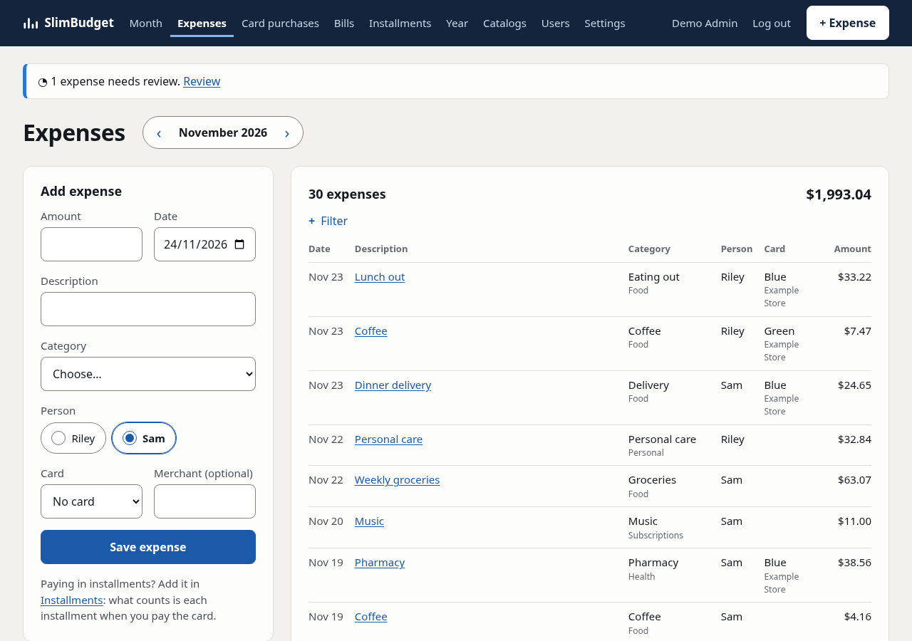
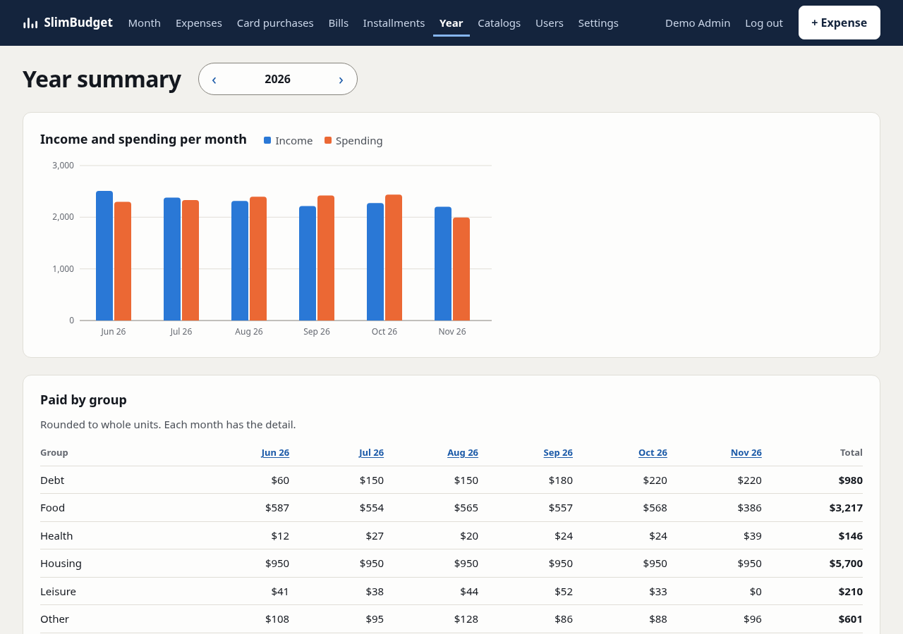
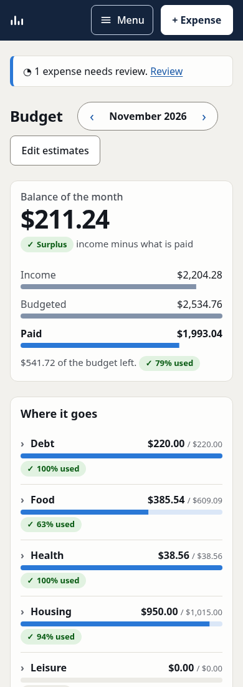

# SlimBudget

A small self-hosted household budget, built with Slim 4, Twig and PDO. No frontend build, no ORM.



- **Month at a glance:** balance, income, budgeted and paid, by group and category.
- **Three kinds of estimate:** fixed, automatic (same as what you paid) or installments.
- **Bills:** recurring bills are created each month; their status comes from the payments you record.
- **Installment plans:** a purchase in installments is not an expense; each installment counts when you pay the card. Includes an 18-month projection.
- **Card payments:** what each card will charge next month, by closing day, without counting any purchase twice.
- **Trends:** typical month, where spending goes up or down, and what changed, by group and category.
- **Two roles:** admins manage everything; members record, read and change only the expenses they recorded.
- **Two-step verification**, with any authenticator app and recovery codes.
- **Any language and currency:** both come from JSON files. English and Spanish included.
- Works on phones, follows the system's dark mode.

| Expenses | Year | Phone |
|---|---|---|
|  |  |  |

## Requirements

PHP 8.4+ with `mbstring`, `openssl` and `pdo_mysql`, Composer, and MariaDB 10.6+ (developed on MariaDB; MySQL 8 is untested).

## Install

```sh
git clone https://github.com/continum4/slimbudget.git
cd slimbudget
composer install --no-dev
```

Create the database and a user for it:

```sql
CREATE DATABASE slimbudget CHARACTER SET utf8mb4 COLLATE utf8mb4_unicode_ci;
CREATE USER 'slimbudget'@'localhost' IDENTIFIED BY 'choose-a-password';
GRANT ALL PRIVILEGES ON slimbudget.* TO 'slimbudget'@'localhost';
```

Then:

```sh
cp config/local.example.php config/local.php       # set the database password, URL and time zone
php bin/migrate.php                                # create the tables
php bin/seed.php starter en                        # optional: groups and categories (en, es)
php bin/user.php alex "Alex" admin                 # prints a temporary password
php -S localhost:8080 -t public public/index.php   # try it
```

To look around first, use `php bin/seed.php demo` on an empty database and sign in as `demo` with the password `slimbudget-demo`.

For daily use, serve `public/` with a real web server: see [`deploy/apache.example.conf`](deploy/apache.example.conf). The web server user needs write access to `var/`. On shared hosting, follow [`deploy/hosting.md`](deploy/hosting.md).

## Update

Back up the database and `config/local.php`, then:

```sh
git pull && composer install --no-dev && php bin/migrate.php
```

## Add a language

Copy `lang/en.json` to `lang/<code>.json` (`fr.json`, `pt-BR.json`…), set `_meta.name` and translate the values. It shows up in Settings, in each profile and on the login page. Missing texts fall back to English, and `composer test` reports missing keys. `"1 item | {count} items"` holds the singular and the plural.

## Add a currency

Add it to [`config/currencies.json`](config/currencies.json):

```json
"NOK": { "name": "Norwegian krone", "symbol": " kr", "position": "after", "decimal": ",", "thousands": ".", "decimals": 2 }
```

An installation uses one currency. Changing it only changes how amounts are shown and typed; nothing is converted.

## How it works

- **Opening a month** copies the previous month's estimates and salary and adds the recurring bills. It happens with a button or with the first expense.
- **"What this person spends counts as income":** for someone who pays part of the expenses from their own money, instead of recording their salary.
- **A bill can follow a whole group** (for example, Food) instead of single payments.
- **Deactivated categories** disappear from the lists, and stay in the months that already have an estimate for them.

## Security

- Hashed passwords, two-step verification (its secrets are stored encrypted), and limits by account and by address on failed sign-ins.
- Changing the password or the two-step verification closes your other sessions. Sessions last 8 hours without use and 24 at most.
- CSRF tokens, a strict Content Security Policy and prepared statements everywhere.
- A history of sign-ins, account changes and deletions, in Users.

It has not been audited by a third party: before putting it on the internet, use HTTPS and turn on two-step verification. Please report vulnerabilities privately through GitHub's security advisories.

## Development

```sh
composer install
composer test                                  # unit tests
cp config/test.example.php config/test.php     # a database whose name ends in _test: it is erased
composer test:e2e                              # walks through the whole app
```

Database changes go in a new file in `database/migrations/`, named with the next number. Interface texts go in every file of `lang/`. Pull requests are welcome.

## License

[MIT](LICENSE)
